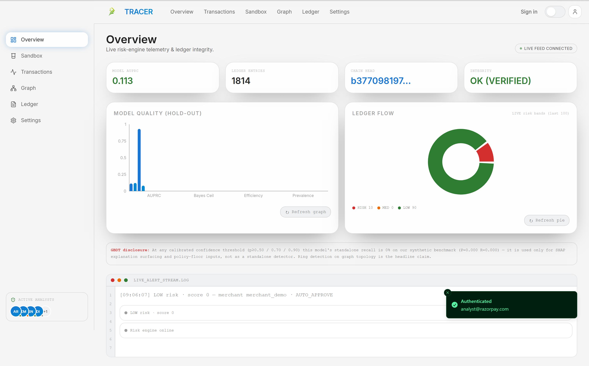
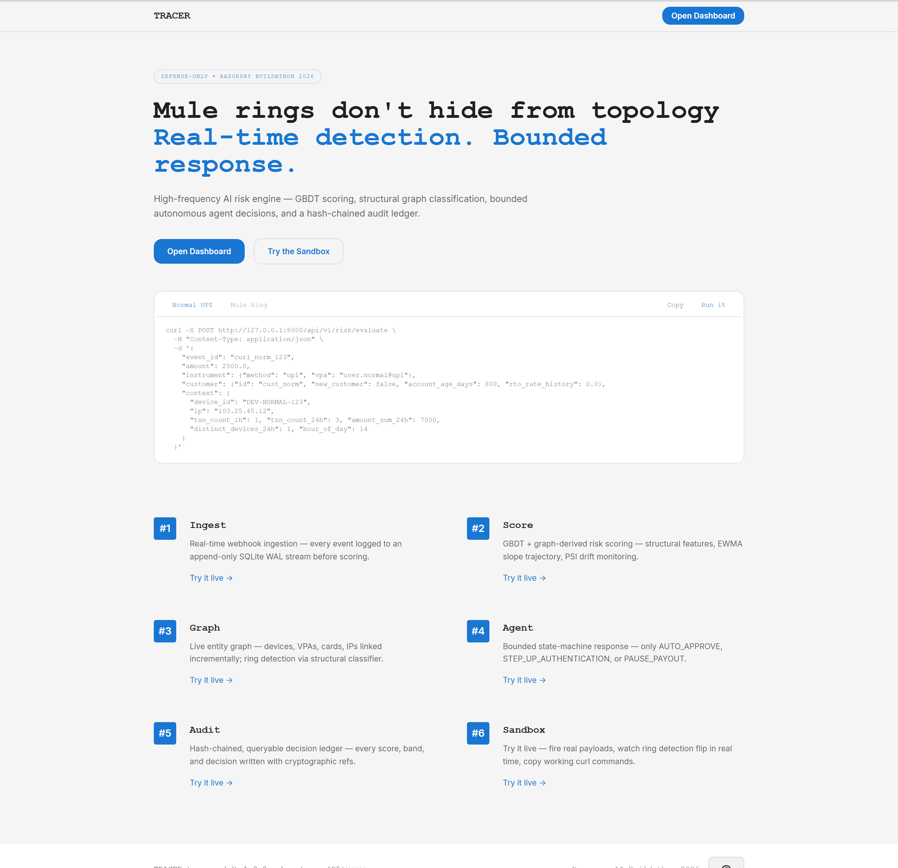
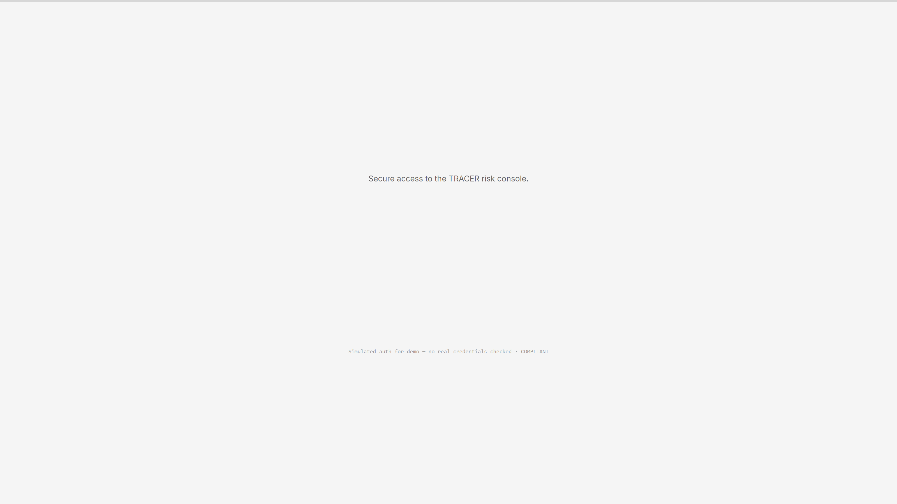
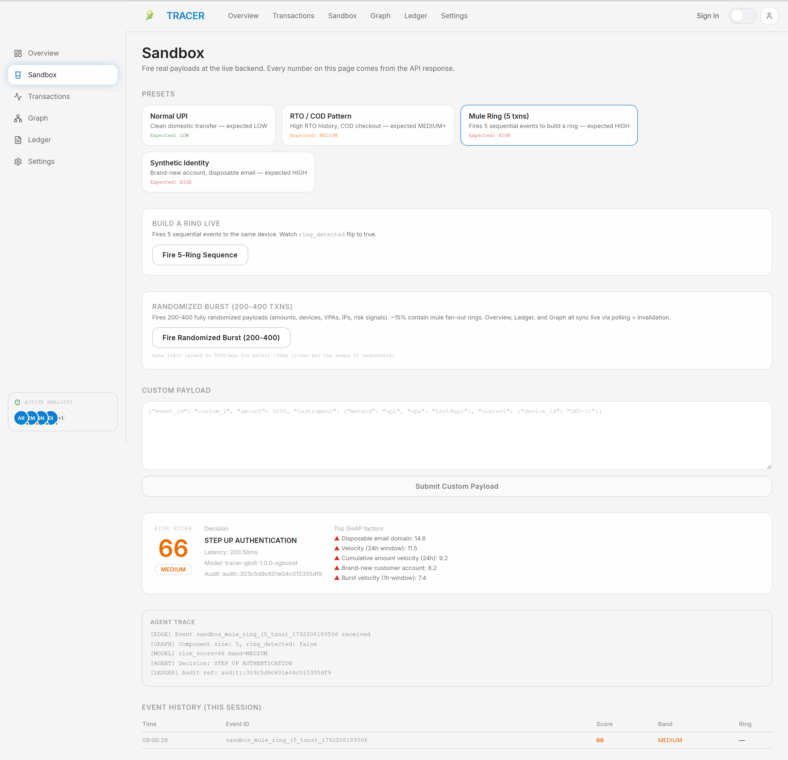
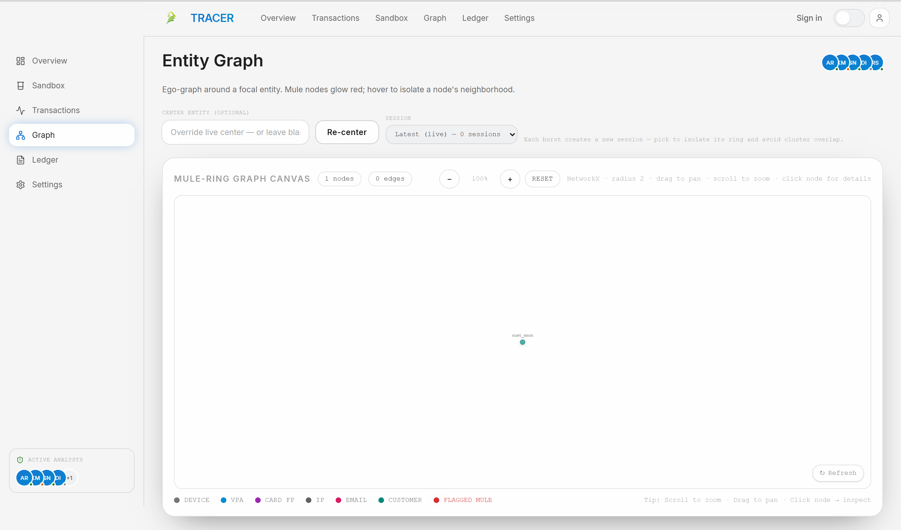
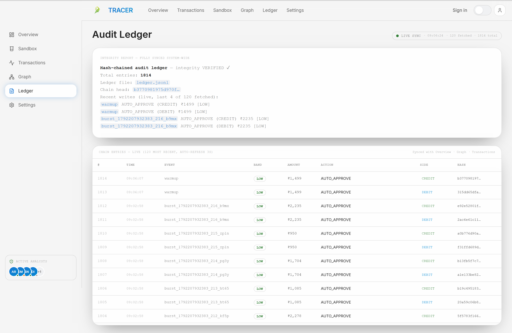
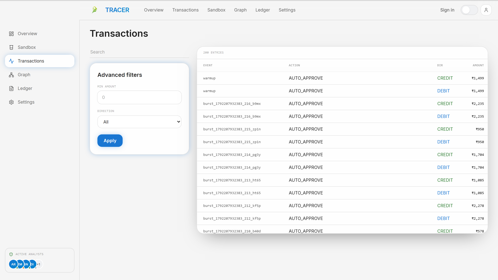
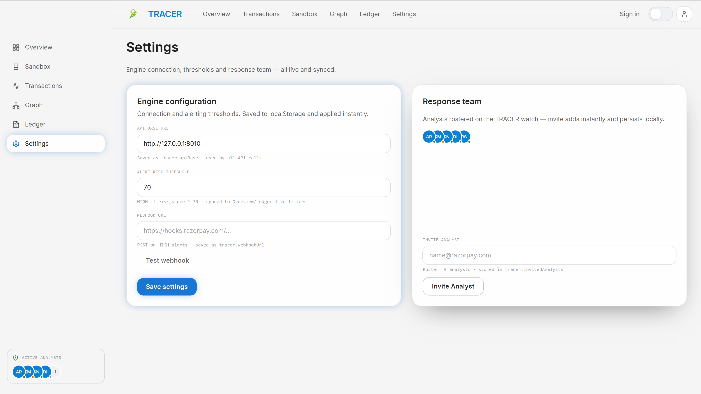
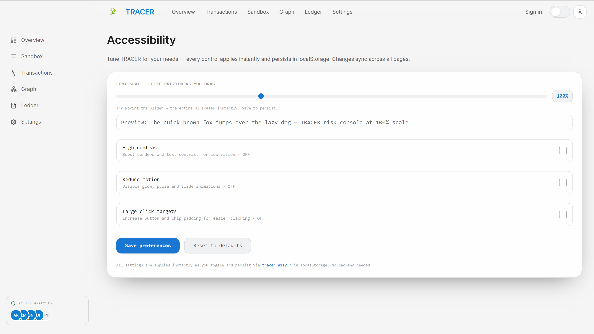

<p align="center">
  
</p>

<h1 align="center">TRACER — Real-Time Mule-Ring Defense</h1>

<p align="center">
  <strong>Razorpay AI Buildathon 2026 · Track 2 · Defense-Only AI Risk Manager</strong>
</p>

<p align="center">
  <a href="https://github.com/WHITEJACK5/TRACER-Real-Time-Mule-Ring-Defense/actions/workflows/ci.yml"></a>
  
  
  
  
</p>

> 🕸️ Mule rings don't hide from topology. TRACER links devices, VPAs, card fingerprints, IPs and emails into a live entity graph, detects fan-out rings and same-amount smurfing in milliseconds, and hands the case to a **bounded** agent that can only approve, step-up, or hold — every action written to a tamper-evident, hash-chained ledger.

---

## 📸 Screenshots

All captures are live against the production build — reproducible via `node frontend/scripts/capture-demo.mjs`.

<p align="center">
  
  <br/>
  <sub><b>Overview</b> — live alert stream, model-quality chart, ledger-flow donut and chain integrity at a glance.</sub>
</p>

| | |
|---|---|
| <br/><sub><b>Landing</b> — copy-paste live API examples</sub> | <br/><sub><b>Sign in</b> — scoped demo session, no real credentials</sub> |
| <br/><sub><b>Sandbox</b> — presets, 5-ring builder, randomized burst</sub> | <br/><sub><b>Graph</b> — rings rendered as structure, not single events</sub> |
| <br/><sub><b>Ledger</b> — hash-chained entries, live sync, integrity report</sub> | <br/><sub><b>Transactions</b> — auditable event log with filters</sub> |
| <br/><sub><b>Settings</b> — engine thresholds and response roster</sub> | <br/><sub><b>Accessibility</b> — font scale, contrast, reduced motion</sub> |

The full set lives in [`docs/screenshots/`](docs/screenshots) (10 captures, including account and theming).

---

## 🗂️ Table of Contents

- [Why TRACER](#-why-tracer)
- [Core Capabilities](#-core-capabilities)
- [Architecture](#-architecture)
- [Tech Stack](#-tech-stack)
- [Quickstart](#-quickstart)
- [Configuration](#-configuration)
- [API Reference](#-api-reference)
- [Testing & Verification](#-testing--verification)
- [Security](#-security)
- [Model Card](#-model-card)
- [Limitations & Path to Production](#-limitations--path-to-production)
- [Documentation](#-documentation)
- [Demo & Media](#-demo--media)
- [Project Structure](#-project-structure)
- [Build Story](#-build-story)
- [Contributing](#-contributing)
- [License](#-license)

---

## 🎯 Why TRACER

**The problem.** One operator sits behind dozens of payment identities. Tabular models score each transaction in isolation and miss the ring entirely — the fraud is in the *links*, not the amounts.

**The approach.** TRACER scores every event, then maps it into a live entity graph where mule rings are detected as structure: cycles, fan-out hubs, shared devices, VPAs, cards and IPs. A bounded policy agent converts risk into one of three actions, and every decision lands in a SHA-256 hash chain that any auditor can verify end-to-end.

**The honest part.** The standalone GBDT's recall on the synthetic benchmark is disclosed as **0%** at calibrated thresholds — it is used for SHAP surfacing and policy floors, not as a standalone detector. The headline claim is graph topology, and the UI says so on the Overview page.

---

## ✨ Core Capabilities

- 🕸️ **Mule-ring detection** — `≥ 4` payment identities sharing one device flags a ring; structural ratio `min(1, fan_out / 4)`
- 💧 **Same-amount repeat smurfing** — same device, same amount `±₹5` or `±2%`, `×4` within `1h / 20 txns` → `MEDIUM` on the 3rd, `HIGH` on the 4th; pattern, not size (amount-agnostic up to ₹1000)
- 🧮 **Component mass floor** — `≥ 3` fan-out nodes with `≥ 8` entities forces a `76` score floor
- 🚫 **Negative control** — one device with 2–3 household VPAs does *not* fire
- 🤖 **Bounded agent** — only `AUTO_APPROVE` (0–30), `STEP_UP` (31–70), `PAUSE` (71–100); no unbounded autonomy
- 🔗 **Tamper-evident ledger** — `SHA256(prev_hash + canonical_event)` chain, `O(1)` head state, double-entry sides, live verification endpoint
- 🧪 **Live sandbox** — 4 labelled presets, a 5-ring builder, and a randomized burst of 200–400 payments (`₹25–5000`, parallel batch 6)
- 📡 **Real-time surfaces** — SSE alert stream with polling fallback; Overview, Ledger, Graph and Notifications stay in sync within ~3 s

---

## 🏗️ Architecture

```
┌───────────────────────────────┐
│  Next.js 16 · App Router      │
│  / → /login → /dashboard/*    │
│  Overview · Sandbox · Graph   │
│  Ledger · Transactions ·      │
│  Settings · Profile · A11y    │
└──────────────┬────────────────┘
               │ REST + SSE
┌──────────────▼────────────────┐
│  FastAPI (backend/app)        │
│  /api/v1/risk/evaluate        │
│  /api/v1/graph/topology       │
│  /api/v1/ledger(/stats)       │
│  /api/v1/stream/alerts (SSE)  │
│  /healthz (503 if chain bad)  │
│  middleware: CORS allow-list, │
│  idempotency (TTL 600),       │
│  rate limiting (5000/min)     │
└─────┬──────────────────┬──────┘
      ▼                  ▼
┌──────────────┐  ┌────────────────┐
│ MuleDetector │  │ amount_repeat  │
│ NetworkX     │  │ ±₹5 / ±2%      │
│ fan-out ≥ 4  │  │ 1h / 20 txns   │
│ mass ≥ 8→76  │  │ 3rd MED, 4th HI│
└──────┬───────┘  └───────┬────────┘
       └─────────┬────────┘
                 ▼
       ┌────────────────────┐
       │ RiskModel (GBDT)   │
       │ XGBoost + SHAP     │
       │ policy floors 88/76│
       └─────────┬──────────┘
                 ▼
       ┌────────────────────┐
       │ Bounded Agent      │
       │ APPROVE/STEP_UP/   │
       │ PAUSE_PAYOUT       │
       └─────────┬──────────┘
                 ▼
       ┌────────────────────┐
       │ AuditLedger        │
       │ SHA256(prev‖evt)   │
       │ O(1) state         │
       └────────────────────┘
```

---

## 🧰 Tech Stack

| Layer | Choice | Why |
|---|---|---|
| **Backend** | FastAPI, Pydantic v2, XGBoost, NetworkX, structlog, prometheus-client | Async API, strict schemas, `O(degree)` in-memory fan-out |
| **Frontend** | Next.js 16 (App Router), React 19, TypeScript, Tailwind, TanStack Query v5, Recharts, Framer Motion, next-themes | Static-first console, live `refetchInterval` polling, tokenized design system |
| **Data** | SQLite (WAL) append-only event log, SHA-256 hash-chained ledger, Redis *(optional)* idempotency, Neo4j *(optional)* graph mirror | Single-process demo; production swaps documented in [ARCHITECTURE.md](ARCHITECTURE.md) |
| **Infra** | Docker + Compose (non-root container, healthchecks), GitHub Actions CI | Reproducible builds and tests on every push |
| **Testing** | pytest (156), Vitest (17), Playwright (6) | Unit → API → E2E coverage |

---

## ⚡ Quickstart

```bash
# 1) Backend — http://127.0.0.1:8000
pip install -r backend/requirements.txt
python -m uvicorn backend.app.main:app --host 0.0.0.0 --port 8000

# 2) Frontend — http://localhost:3000
cd frontend
npm install
npm run dev                      # dev mode
# production build: npm run build && npx next start -p 3000

# 3) Or the whole stack in Docker
docker compose up --build
# Containers run as non-root with ENVIRONMENT=production + DOCS_ENABLED=false.
# Real deployments must set RAZORPAY_WEBHOOK_SECRET (≥ 32 chars) — the backend
# fails fast at startup otherwise.
```

Open `http://localhost:3000` → **Open Dashboard** → sign in with any email + passphrase (simulated demo session).

**Try a ring in 30 seconds:**

```bash
curl -X POST http://127.0.0.1:8000/api/v1/risk/evaluate \
 -H "Content-Type: application/json" -H "X-Idempotency-Key: demo-1" \
 -d '{"event_id":"curl_norm_1","amount":2500,"instrument":{"method":"upi","vpa":"user.normal@upi"},"customer":{"id":"cust_norm","new_customer":false,"account_age_days":800},"context":{"device_id":"DEV-NORMAL-1","ip":"103.25.45.12","txn_count_1h":1}}'
```

Then in the UI: **Sandbox → Fire 5-Ring Sequence** → watch `Graph` render the ring and `Ledger` record `HIGH` with `ring_detected: true`.

---

## ⚙️ Configuration

Copy `.env.example` → `.env`:

```ini
ENVIRONMENT=development            # production → fail-fast on weak/missing secrets
DOCS_ENABLED=1                     # /docs + /openapi.json (off in Docker defaults)
REDIS_URL=                         # optional → in-memory fallback
NEO4J_URI=                         # optional non-blocking graph mirror
RAZORPAY_WEBHOOK_SECRET=           # REQUIRED (≥ 32 chars) when ENVIRONMENT=production
REQUIRE_WEBHOOK_SECRET=0           # 1 → reject unsigned webhooks (403)
IDEMPOTENCY_TTL_SECONDS=600
NEXT_PUBLIC_API_BASE=http://127.0.0.1:8000
```

---

## 🔌 API Reference

| Method | Path | Auth | Description |
|---|---|---|---|
| `GET` | `/healthz` | — | `200 ok` / `503 degraded` with `audit_chain_verified`, `uptime_s` |
| `POST` | `/api/v1/risk/evaluate` | `X-Idempotency-Key` | Main scoring: `TransactionEvent` → `risk_score`, `risk_band`, `graph_evidence`, `shap` |
| `GET` | `/api/v1/graph/topology?center=&session=` | — | Ego-graph (radius 2), per-session isolation when `session` set |
| `POST` | `/api/v1/graph/reset-demo` | — | Clears demo graph state |
| `GET` | `/api/v1/ledger/stats` | — | `entries`, `chain_verified`, `chain_head` |
| `GET` | `/api/v1/ledger?limit=120` | — | Recent hash-chained audit entries |
| `GET` | `/api/v1/model/report` | — | Honest hold-out metrics card |
| `GET` | `/api/v1/model/info` | — | `model_version`, `artifact_sha256`, `feature_names` |
| `GET` | `/api/v1/presets` | — | Sample payloads used by the Sandbox |
| `POST` | `/api/v1/webhooks/razorpay` | HMAC `X-Razorpay-Signature` | Dual-mode: `403` on unsigned when `REQUIRE_WEBHOOK_SECRET=1` |
| `GET` | `/api/v1/alerts` · `/api/v1/stream/alerts` | — | Polling fallback · SSE live stream |

---

## 🧪 Testing & Verification

| Check | Command | Result |
|---|---|---|
| Backend | `python -m pytest backend/tests -q` | **156 passed** — bands, idempotent replay, HMAC, ring detection, negative control, prompt injection, ledger tamper-evidence |
| Unit | `npm run test` | **17 passed** (7 files) |
| E2E | `npm run test:e2e` | **6 passed** (Playwright, production build) |
| Types | `npx tsc --noEmit` | 0 errors |
| Lint | `npm run lint` | 0 warnings |
| Build | `npm run build` | 13 routes, all statically prerendered |
| Security | `bandit -q --severity-level medium backend/` · `pip-audit` · `npm audit` | 0 medium+ · clean · 7 high dev-only ([SECURITY.md](SECURITY.md)) |

CI ([`.github/workflows/ci.yml`](.github/workflows/ci.yml)) runs 4 jobs on every push: `backend-tests`, `lint-and-typecheck`, `build`, `e2e`.

### Reproduction commands

| Command | What it proves |
|---|---|
| `python data/generate_synthetic.py` | GBDT vs independent ground truth (nonlinear + confounder + 6.5% label flip) |
| `python scripts/bench_latency.py` | `p50/p95/p99` per-payment latency |
| `curl localhost:8000/api/v1/model/report` | Live honest-metrics card |

### Latency — measured single uvicorn, NetworkX, no Redis

```
SEQUENTIAL (n=200):     p50=53.3ms  p95=69.7ms  p99=78.1ms  max=100.6ms  18 req/s
CONCURRENT (n=600,c=10): p50=376.8ms                              26 req/s
```

### Model quality — synthetic sanity check (not real-world)

`data/ground_truth.py` shares **zero code** with the scorer; `amount_log` enters the logit only via a confounder (amount-agnostic).

```
AUPRC                 : 0.095   (baseline 0.086)
Bayes ceiling AUPRC   : 0.114   (label-noise bound)
efficiency vs ceiling : 83%
```

> **GBDT standalone recall at `p ≥ 0.50/0.70/0.90` is 0%** on this synthetic benchmark (`P=0.000 R=0.000`) — used only for SHAP surfacing and policy floors.

### Same-amount repeat (amount-agnostic up to ₹1000)

```
Same device, same amount 500×4 → LOW, LOW, MEDIUM, HIGH   (4th triggers 88 floor)
High amount, clean history 50000 → LOW                     (fan_out = 1)
```

---

## 🔐 Security

- **Webhooks** — HMAC-SHA256 verified when `RAZORPAY_WEBHOOK_SECRET` is set; unsigned requests carry `verified:false` + reason, or `403` when `REQUIRE_WEBHOOK_SECRET=1`
- **Prompt-injection defense** — all VPA/email/note strings sanitized before any LLM use (control/zero-width stripped, markers dropped, length capped); covered by `test_prompt_injection_is_neutralized`
- **CORS** — explicit allow-list with `allow_credentials`, explicit headers and methods (no `*`)
- **Idempotency** — `X-Idempotency-Key`, TTL 600 s, Redis → in-memory fallback
- **Ledger** — `SHA256(prev_hash‖canonical)` double-entry chain; `/healthz` flips to `503` if verification fails
- **Supply chain** — `pip-audit` clean; `bandit` gate at Medium+ in pre-commit; the 7 `npm audit` highs are dev/build-toolchain only and documented in [SECURITY.md](SECURITY.md)
- **Containers** — non-root user, healthchecks, production fail-fast on weak secrets

See [THREAT_MODEL.md](THREAT_MODEL.md) for the full threat model.

---

## 📊 Model Card

- **Detects:** device→identity fan-out, same-amount repeat smurfing (≤ ₹1000), velocity bursts, COD/RTO abuse, synthetic identity
- **Does not detect:** off-platform collusion with no shared entities, cold-start identifiers, cross-merchant patterns
- **Validated on:** decoupled synthetic ground truth, live-API ring wiring tests, same-amount repeat unit tests
- **Heuristic fallback anchors (SHAP):** `mule_confidence 3.40`, `device_fan_out 3.20` ≫ `amount_log 0.18` — pattern beats amount

---

## ⚠️ Limitations & Path to Production

This is a **hackathon prototype**:

- **Training data** — synthetic; production needs real chargeback-labeled, time-based holdouts
- **Device identity** — `device_id` is self-reported; production needs FingerprintJS/ThreatMetrix-class signals
- **Scale** — single-node NetworkX + SQLite; production → Redis Cluster, TigerGraph/Neo4j, Kafka streaming
- **Ledger** — single file without rotation; production needs partitioned WAL + cold storage
- **Review loop** — labeling endpoint exists; no analyst queue UI yet

More trade-offs in [LIMITATIONS.md](LIMITATIONS.md) and [DECISIONS.md](DECISIONS.md).

---

## 📚 Documentation

| Doc | Contents |
|---|---|
| [ARCHITECTURE.md](ARCHITECTURE.md) | System design and data flow |
| [WIRING_AUDIT.md](WIRING_AUDIT.md) | **33/33 verified** end-to-end wiring audit |
| [THREAT_MODEL.md](THREAT_MODEL.md) · [SECURITY.md](SECURITY.md) | Threats, controls, dependency posture |
| [EVASION_COST.md](EVASION_COST.md) · [COST_MODEL.md](COST_MODEL.md) | Adversary economics and unit costs |
| [DECISIONS.md](DECISIONS.md) · [LIMITATIONS.md](LIMITATIONS.md) · [PHASE0_AUDIT.md](PHASE0_AUDIT.md) | Design trade-offs and honest gaps |
| [CHANGELOG.md](CHANGELOG.md) | Release history |

---

## 🎬 Demo & Media

Two end-to-end console walkthroughs, versioned in `docs/videos/` (frontend `:3000`, backend `:8000`):

<video src="docs/videos/capture-213002.mp4" controls width="800"></video>

- **Part 1** — analyst flow: landing → sign-in → overview → sandbox burst → ledger verification. [Download](docs/videos/capture-213002.mp4) (69.9 MB)
- **Part 2** — settings, profile, theming, notifications. [Download](docs/videos/capture-213139.mp4) (95.2 MB)

<video src="docs/videos/capture-213139.mp4" controls width="800"></video>

Every screenshot is reproducible: `node frontend/scripts/capture-demo.mjs` drives the live app, writes 10 screenshots and records a walkthrough webm.

---

## 🗂️ Project Structure

```
RPTracer/
├── backend/
│   ├── app/              # FastAPI: api/v1, core, models, services, infrastructure
│   └── tests/            # 156 pytest tests
├── frontend/
│   ├── app/              # App Router pages (landing, login, dashboard/*)
│   ├── components/       # charts, graph canvas, header/sidebar, UI kit
│   ├── e2e/              # 6 Playwright specs
│   └── scripts/          # capture-demo.mjs — screenshots + walkthrough video
├── data/                 # ground truth, schema, live hash-chained ledger
├── docs/                 # screenshots + demo videos
└── *.md                  # architecture, security, audits, decisions
```

---

## 🧭 Build Story

- **Day 1** — ring-detection prototype: device fan-out (≥ 4 identities) + household negative control
- **Day 2** — graph isolation: `session_id` per burst so each run renders its own ring
- **Day 3** — same-amount repeat detector: tolerance `max(±₹5, ±2%)`, MEDIUM 3rd / HIGH 4th in 1 h / 20 txns
- **Day 4** — burst throughput: parallel `BATCH=6` lifting the demo to ~18 rps
- **Day 5** — benchmarks + honest disclosure: latency numbers and GBDT 0%-recall surfaced in the UI
- **Day 6** — media + hardening: versioned captures, audit fixes, CI green

---

## 🤝 Contributing

Conventional commits · pre-commit hooks (`ruff`, `bandit` Medium+ gate) · CI must pass. See [CONTRIBUTING.md](CONTRIBUTING.md) and [CODE_OF_CONDUCT.md](CODE_OF_CONDUCT.md).

## 📄 License

MIT — see [LICENSE](LICENSE).

## 🙌 Credits

Built for **Razorpay AI Buildathon 2026 · Track 2** by the TRACER team.
